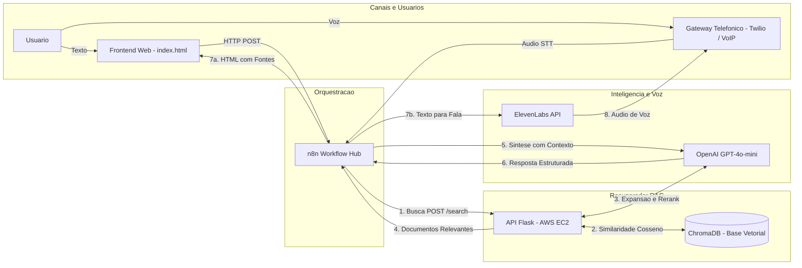

# 🤖 ERP Helpper — Assistente Inteligente Multicanal (RAG) para UNO ERP

<p align="center">
  
  
  
  
  
  
  
  
</p>

---

## 📌 Sumário
- [1. Visão Geral e Contexto](#1-visão-geral-e-contexto)
- [2. Links de Deploy e Endpoints](#2-links-de-deploy-e-endpoints)
- [3. Arquitetura da Solução](#3-arquitetura-da-solução)
- [4. Requisitos do Sistema (RF e RNF)](#4-requisitos-do-sistema-rf-e-rnf)
- [5. Workflow do n8n (Exportado e Documentado)](#5-workflow-do-n8n-exportado-e-documentado)
- [6. Tecnologias Utilizadas](#6-tecnologias-utilizadas)
- [7. Como Rodar o Projeto Localmente](#7-como-rodar-o-projeto-localmente)
- [8. Execução com Docker](#8-execução-com-docker)
- [9. Estrutura de Diretórios e Documentação Modular](#9-estrutura-de-diretórios-e-documentação-modular)
- [10. Integração Contínua (CI / GitHub Actions)](#10-integração-contínua-ci--github-actions)
- [11. Histórico de Problemas e Mitigações de Custos](#11-histórico-de-problemas-e-mitigações-de-custos)
- [12. Autoria e Licença](#12-autoria-e-licença)

---

## 1. Visão Geral e Contexto

O **ERP Helpper** é um agente de Inteligência Artificial multicanal projetado para tirar dúvidas operacionais cotidianas e sanar erros recorrentes de usuários do **UNO ERP** (com ênfase em rejeições fiscais de NFe, configurações de faturamento e regras de tela).

- **O Problema:** A equipe de suporte humano N1 recebia centenas de chamados repetitivos diariamente para dúvidas já documentadas nos manuais.
- **A Solução:** Um assistente virtual baseado em **RAG** (*Retrieval-Augmented Generation*) que consulta a base oficial do ERP em um banco vetorial de alta performance (**ChromaDB**) e formula respostas estruturadas sem alucinações.
- **Evolução Multicanal:**
  - **Fase 1 (Web Chat):** Interface conversacional web ágil e moderna com histórico e fontes oficiais.
  - **Fase 2 (Canal Telefônico / Voz):** Atendimento por ligação telefônica humanizada com síntese de voz neural (**ElevenLabs**) e reconhecimento de voz em tempo real (**Full Duplex**).
- **Alinhamento com Stakeholders:** Todo o escopo, requisitos e priorizações foram validados em reuniões técnicas com o representante da empresa parceira, **Tiago Garcia Amato**, e a coordenação de projeto (**Cesar**).

---

## 2. Links de Deploy e Endpoints

| Recurso | Ambiente | Status | Link de Acesso |
| :--- | :--- | :---: | :--- |
| 🌐 **Frontend Web (Chat)** | GitHub Pages | Online | [Acessar Interface do Chatbot](https://fonseca0015.github.io/chatBotAWS1/) |
| ⚡ **Search API (Flask/ChromaDB)** | AWS EC2 (Produção) | Ativo | `http://44.203.191.31:5000/search` |
| 🔄 **Webhook do Orquestrador** | n8n Cloud | Ativo | `https://unoerpai.app.n8n.cloud/webhook/c7683d30-5ffb-448b-a9cb-2dac0ac443bb` |
| 📦 **Workflow n8n Exportado** | Repositório | Disponível | [Arquivo JSON do Fluxo](n8n/workflow_uno_erp_helpper.json) |
| 📞 **Gateway Telefônico (Canal de Voz)** | Telecom | Homologação | Integrado via Twilio / ElevenLabs |

Para detalhes da arquitetura em nuvem (AWS EC2, Nginx, Gunicorn e SSL), consulte o [Guia de Deploy](docs/10_guia_deploy.md).

---

## 3. Arquitetura da Solução

O fluxo opera de ponta a ponta com separação estrita de responsabilidades:



Para a especificação completa de cada componente e fluxos de dados, acesse [Arquitetura e Fluxos](docs/04_arquitetura_e_fluxos.md).

---

## 4. Requisitos do Sistema (RF e RNF)

### Requisitos Funcionais em Destaque
- **RF01:** Atender via Chatbot na web.
- **RF02 & RF10:** Interação exclusiva por voz em chamada telefônica via Gateway VoIP/Twilio.
- **RF03 & RF04:** Consulta à base vetorial e respostas imediatas a dúvidas frequentes.
- **RF05:** Escalonamento automático para o Suporte N1 em dúvidas complexas/não resolvidas.
- **RF06:** Atualização contínua e reindexação da base de conhecimento.
- **RF07 & RF08:** Reconhecimento de fala (STT) e síntese de voz profissional (ElevenLabs TTS).
- **RF09:** Gestão de turnos duplex (identificação de pausas sem atropelar a fala).

### Requisitos Não Funcionais em Destaque
- **RNF01 & RNF06:** Latência otimizada fim a fim $\le 2,5$ segundos no canal de voz.
- **RNF02:** Interface ergonômica com tema escuro e visual moderno.
- **RNF04:** Preservação de sigilo das credenciais e dados empresariais.
- **RNF08:** Gestão proativa de consumo de créditos (ElevenLabs, tokens OpenAI e execuções n8n).

Consulte o documento completo em [Especificação de Requisitos](docs/02_requisitos.md).

---

## 5. Workflow do n8n (Exportado e Documentado)

O fluxo oficial que orquestra a inteligência do ERP Helpper está versionado e documentado no repositório:
- 📁 **Arquivo para importação direta:** [`n8n/workflow_uno_erp_helpper.json`](n8n/workflow_uno_erp_helpper.json)
- 📖 **Documentação completa nó a nó:** [Workflow do n8n](docs/11_workflow_n8n.md)

### Destaques do Workflow:
1. **Nós Webhook:** Recebem a pergunta enviada pela interface web ou canal de telefonia.
2. **Nó HTTP Request:** Consulta a Search API Flask hospedada na AWS (`http://44.203.191.31:5000/search`).
3. **Agregação em JavaScript:** Agrupa os trechos dos documentos e consolida as fontes oficiais.
4. **AI Agent (LangChain) com `gpt-4o-mini`:** Aplica regras rigorosas de amigabilidade, didática passo a passo, proibição de alucinações e tratamento amigável de saudações.
5. **Higienização em JavaScript:** Converte marcações em HTML seguro e filtra links externos, permitindo apenas URLs do portal oficial `unoerpwiki.herokuapp.com`.

---

## 6. Tecnologias Utilizadas

- **Back-end & API:** Python 3.10+, Flask, tiktoken, python-dotenv, tqdm.
- **Base Vetorial:** ChromaDB (HNSW, métrica de similaridade por cosseno).
- **Inteligência Artificial:** OpenAI `text-embedding-3-small` (1536 dimensões) e `gpt-4o-mini`.
- **Orquestração:** n8n Cloud / Community Edition, JavaScript para formatação de saídas.
- **Síntese de Voz:** ElevenLabs API (modelos Multilingual v2 / Flash / Turbo).
- **Frontend:** HTML5, CSS3 moderno, Vanilla JavaScript.
- **Infraestrutura & CI/CD:** Docker, Docker Compose, AWS EC2, GitHub Actions.
- **Ecossistema:** Twilio/VoIP, Lovable, Bubble, OpenClaw, ViverdeIA, MCP e WhatsApp.

Detalhes completos e bibliografia em [Tecnologias e Integrações](docs/08_tecnologias_e_integracoes.md).

---

## 7. Como Rodar o Projeto Localmente

### 1. Clonar o Repositório
```bash
git clone https://github.com/fonseca0015/chatBotAWS1.git
cd chatBotAWS1
```

### 2. Criar e Ativar o Ambiente Virtual
- **Windows (PowerShell):**
  ```powershell
  python -m venv venv
  .\venv\Scripts\Activate.ps1
  ```
- **Linux / macOS:**
  ```bash
  python3 -m venv venv
  source venv/bin/activate
  ```

### 3. Instalar Dependências
```bash
pip install -r requirements.txt
```

### 4. Configurar as Chaves no `.env`
Copie o modelo de ambiente:
```bash
# Windows
Copy-Item .env.example .env

# Linux/macOS
cp .env.example .env
```
Edite o arquivo `.env` inserindo sua chave da OpenAI:
```dotenv
OPENAI_API_KEY=sk-proj-sua-chave-aqui
```

### 5. Iniciar a API de Busca
```bash
python main.py
```
> O ChromaDB será carregado ou populado automaticamente a partir do arquivo `knowledge_base.json` (531 artigos). O servidor responderá na porta `5000`.

### 6. Testar o Endpoint `/search`
```bash
curl -X POST http://127.0.0.1:5000/search \
  -H "Content-Type: application/json" \
  -d '{"pergunta": "Como tratar a rejeição 201?"}'
```

### 7. Abrir o Chat Web
Dê dois cliques no arquivo `index.html` ou execute `python -m http.server 8080` e acesse `http://localhost:8080`.

Consulte o passo a passo ilustrado em [Guia de Execução Local](docs/09_guia_execucao_local.md).

---

## 8. Execução com Docker

Caso prefira rodar toda a aplicação em containers isolados:
```bash
# 1. Configurar o .env com sua OPENAI_API_KEY
cp .env.example .env

# 2. Subir o container
docker compose up -d --build

# 3. Monitorar logs
docker compose logs -f
```

---

## 9. Estrutura de Diretórios e Documentação Modular

O repositório está organizado de forma clara e modular:

```
chatBotAWS1/
├── .github/
│   └── workflows/
│       └── ci.yml                     # Pipeline de CI/CD do GitHub Actions
├── base_de_conhecimento_db/           # Base vetorial persistente do ChromaDB
├── docs/                              # 📚 Documentação Técnica Completa
│   ├── 01_contexto_e_visao_geral.md   # Contexto de negócio, objetivos e histórico
│   ├── 02_requisitos.md               # RF01-RF10 e RNF01-RNF09 com critérios
│   ├── 03_casos_de_uso.md             # Diagramas e especificações de casos de uso
│   ├── 04_arquitetura_e_fluxos.md     # Arquitetura RAG e fluxos Web vs Voz
│   ├── 05_modelo_de_dados.md          # Modelos Conceitual, Lógico e Chunks
│   ├── 06_pipeline_search_atividades.md # Diagrama de Atividades detalhado do /search
│   ├── 07_relatorio_riscos_e_custos.md  # Análise de custos ElevenLabs, n8n e OpenAI
│   ├── 08_tecnologias_e_integracoes.md  # Stack, ferramentas e referências
│   ├── 09_guia_execucao_local.md      # Manual de configuração local detalhado
│   ├── 10_guia_deploy.md              # Deploy AWS, Docker, Nginx, SSL e Links
│   └── 11_workflow_n8n.md             # Documentação completa do fluxo n8n
├── n8n/
│   └── workflow_uno_erp_helpper.json  # Workflow oficial exportado para importação
├── test_api.py                        # Script de validação e testes da API
├── .env.example                       # Modelo de variáveis de ambiente
├── .gitignore                         # Regras de exclusão do Git
├── Dockerfile                         # Imagem Docker da aplicação
├── docker-compose.yml                 # Orquestração local do container
├── index.html                         # Interface Web do Chatbot (SPA)
├── knowledge_base.json                # Base de conhecimento documental (JSON)
├── main.py                            # Servidor Flask e Search Engine RAG
├── requirements.txt                   # Dependências Python do projeto
└── README.md                          # Este documento principal
```

---

## 10. Integração Contínua (CI / GitHub Actions)

O repositório possui uma pipeline automatizada no arquivo [`.github/workflows/ci.yml`](.github/workflows/ci.yml) que é executada a cada `push` e `pull_request` nas branches principais:
1. Validação de sintaxe Python com `py_compile`.
2. Análise estática de código com `flake8` contra erros de execução.
3. Validação estrutural do arquivo de conhecimento `knowledge_base.json`.
4. Validação do arquivo JSON do workflow do n8n (`n8n/workflow_uno_erp_helpper.json`).
5. Checagem de integridade dos arquivos obrigatórios do ecossistema.

---

## 11. Histórico de Problemas e Mitigações de Custos

Um dos marcos do projeto foi o diagnóstico e resolução do problema na busca semântica documental:
- **Causa Raiz:** Ausência temporária de tokens da OpenAI e desalinhamento na persistência de coleções do ChromaDB.
- **Solução Implementada:** Tratamento automático de inicialização em `main.py`, bypass de rerank para códigos críticos (ex: **Rejeição 201** -> Doc 314) e implementação de fallbacks automáticos.
- **Gestão de Custos:** Recomenda-se a contratação do plano Creator/Pro da ElevenLabs para chamadas de voz com respostas resumidas ($\le 300$ caracteres) e a utilização da versão **Community Edition auto-hospedada do n8n** para contornar os limites mensais de execução do plano Cloud.

Para leitura completa do relatório executivo, veja o [Relatório de Riscos e Custos](docs/07_relatorio_riscos_e_custos.md).

---

## 12. Autoria e Licença

- **Projeto:** ERP Helpper — Assistente Inteligente para UNO ERP
- **Alinhamento e Homologação:** Tiago Garcia Amato & Cesar
- **Desenvolvimento:** Equipe de Engenharia do Projeto UNO ERP Helpper
- **Licença:** Este projeto é distribuído para uso e homologação no escopo da parceria UNO ERP.
