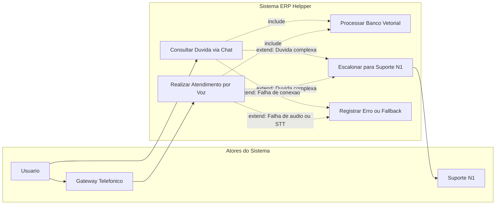

# Especificação de Casos de Uso (Base Monografia FATEC)

## 1. Diagrama Geral de Casos de Uso

O diagrama a seguir sintetiza as interações entre os atores do sistema (**Usuário**, **Gateway Telefônico** e **Suporte N1**) e as funcionalidades do **ERP Helpper**, em estrita conformidade com a documentação do Projeto Integrador da FATEC Sorocaba.

---

## 2. Atores do Sistema

| Ator | Tipo | Papel no Sistema |
| :--- | :--- | :--- |
| **Usuário** | Primário (Humano) | Operador do UNO ERP que submete dúvidas pelo chat web ou via chamada telefônica. |
| **Gateway Telefônico** | Secundário (Sistema) | Plataforma de telecomunicações (ex.: Twilio ConversationRelay / SIP VoIP) que gerencia a sessão de chamada, áudio e streaming duplex. |
| **Suporte N1** | Secundário (Humano) | Equipe de atendimento humano da Uno Soluções que recebe os chamados de alta complexidade ou que extrapolam a base de conhecimento. |

---

## 3. Quadros Narrativos dos Casos de Uso (Detalhamento Baixo Nível)

### Quadro 1. Caso de Uso: Realizar Atendimento por Voz / Atender Chamada Telefônica
- **Requisitos Atendidos:** RF01, RF02, RF03, RF04, RF07, RF08, RF09, RF10
- **Ator Principal:** Usuário
- **Ator Secundário:** Gateway Telefônico
- **Pré-Condição:** O usuário liga para o número da Uno Soluções e a chamada é roteada para o ERP Helpper. A Search API e o banco vetorial estão online.
- **Pós-Condição:** Uma resposta precisa fundamentada na documentação é falada ao usuário via síntese de voz (TTS ElevenLabs), com proposta de resolução.

| Passo | Ação do Ator | Ação do Sistema |
| :---: | :--- | :--- |
| **1** | O usuário realiza a ligação telefônica para o suporte. | |
| **2** | | O Gateway Telefônico atende a chamada e o sistema emite saudação cordial convidando o usuário a expor a dúvida. |
| **3** | O usuário fala a sua dúvida (ex.: *"Estou com a rejeição 201 ao emitir nota fiscal"*). | |
| **4** | | O sistema converte a fala em texto em tempo real (Speech-to-Text) com detecção de turnos (Duplex). |
| **5** | | O sistema consulta a base vetorial e resgata os trechos pertinentes. |
| **6** | | O sistema sintetiza uma resposta oral concisa e objetiva (sem markdown e sem links) através do modelo gerador e do ElevenLabs. |
| **7** | | O áudio gerado é transmitido na ligação telefônica de volta ao usuário. |

---

### Quadro 2. Caso de Uso: Processar Banco Vetorial
- **Requisitos Atendidos:** RF03, RF06
- **Ator Principal:** Usuário / Desenvolvedor
- **Ator Secundário:** Suporte N1
- **Pré-Condição:** O sistema deve acessar a documentação e histórico de procedimentos homologados da Uno Soluções e prepará-los para o pipeline RAG.
- **Pós-Condição:** Os textos estão fatiados em chunks, vetorizados via `text-embedding-3-small` e indexados no ChromaDB com métrica de similaridade de cosseno.

| Passo | Ação do Ator | Ação do Sistema |
| :---: | :--- | :--- |
| **1** | O desenvolvedor/administrador inicia a API ou insere novos manuais em `knowledge_base.json`. | |
| **2** | | O sistema fatiará o conteúdo em chunks com a biblioteca `tiktoken` (`max_tokens=2000`, `overlap=500`). |
| **3** | | O sistema envia os lotes para a API da OpenAI gerando embeddings de 1536 dimensões. |
| **4** | | Os vetores e metadados estruturados são persistidos no ChromaDB (`docs_uno_erp_cosine`). |
| **5** | | A base fica pronta para buscas semânticas ultrarrápidas em produção. |

---

### Quadro 3. Caso de Uso: Registrar Erro / Fallback
- **Requisitos Atendidos:** RNF07, RNF09
- **Ator Principal:** Usuário
- **Ator Secundário:** Sistema de Monitoramento / Suporte N1
- **Pré-Condição:** O sistema reconhece falha na transcrição de áudio por excesso de ruído, indisponibilidade momentânea de rede ou falta de saldo em provedores de IA.
- **Pós-Condição:** O usuário é informado educadamente sobre a instabilidade e o sistema registra log de contingência, oferecendo repetição da dúvida.

| Passo | Ação do Ator | Ação do Sistema |
| :---: | :--- | :--- |
| **1** | O usuário submete uma mensagem ininteligível ou a chamada telefônica sofre perda de pacotes. | |
| **2** | | O sistema detecta o erro ou baixa confiança na transcrição. |
| **3** | | O sistema informa: *"Desculpe, não consegui entender com clareza. Você poderia repetir ou reformular?"* |
| **4** | | O erro é gravado nos logs do servidor para auditoria da equipe técnica. |

---

### Quadro 4. Caso de Uso: Escalonar para o Suporte N1
- **Requisitos Atendidos:** RF05
- **Ator Principal:** Usuário
- **Ator Secundário:** Suporte N1 (Humano)
- **Pré-Condição:** O sistema reconhece que a dúvida não consta na documentação oficial ou que o problema exige intervenções manuais no banco de dados do ERP.
- **Pós-Condição:** O atendimento é redirecionado para a fila de atendimento humano do Suporte N1 da Uno Soluções.

| Passo | Ação do Ator | Ação do Sistema |
| :---: | :--- | :--- |
| **1** | O usuário relata uma situação crítica ou inconsistência interna do ERP que não possui solução em manuais. | |
| **2** | | O RAG processa a busca e constata ausência de trechos satisfatórios no ChromaDB. |
| **3** | | O agente informa: *"Não localizei essa rotina na base de conhecimento. Estou transferindo você para a nossa equipe de suporte N1."* |
| **4** | | O ticket ou a chamada é encaminhado para o atendente humano com o histórico da conversa pré-carregado. |
