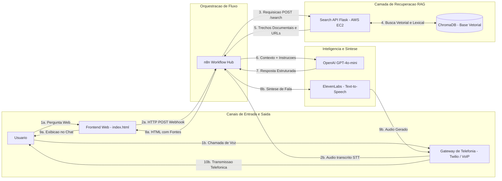

# Arquitetura da Aplicação e Fluxos do Sistema

## 1. Visão Geral da Arquitetura RAG
A arquitetura do **ERP Helpper** adota o padrão **RAG** (*Retrieval-Augmented Generation*), garantindo que as respostas geradas pelos modelos de linguagem sejam estritamente embasadas em trechos reais da documentação oficial do UNO ERP. O sistema opera de maneira desacoplada e modular, integrando canais digitais (Web) e de telecomunicações (Voz/Telefonia).

---

## 2. Detalhamento dos Componentes e Papéis

| Componente | Tecnologia | Papel e Responsabilidades |
| :--- | :--- | :--- |
| **Frontend Web** | HTML5, CSS3, JavaScript nativo | Interface conversacional de autoatendimento. Captura a pergunta do usuário, exibe animação de digitação, renderiza a resposta com suporte a formatação HTML e lista fontes de documentação com links clicáveis. |
| **Gateway de Telefonia** | Twilio / Provedores SIP / VoIP | Ponto de contato para chamadas telefônicas convencionais. Converte o fluxo de voz analógico/digital para transmissão de dados via internet e gerencia os canais de áudio duplex. |
| **Orquestrador de Fluxo** | n8n (Cloud ou Self-Hosted) | Hub de orquestração assíncrona. Recebe os webhooks do frontend e da telefonia, aciona a Search API para recuperação documental, formata o prompt de sistema, dispara o modelo da OpenAI e prepara o payload de saída (HTML para web ou chamada à ElevenLabs para voz). |
| **Search API (Servidor)** | Python 3.10+, Flask (Deploy AWS EC2 `44.203.191.31:5000`) | Microserviço REST que expõe a rota `/search`. Implementa expansão de consulta, busca híbrida (semântica vetorial + lexical) e reranking inteligente de candidatos. |
| **Banco Vetorial** | ChromaDB (`hnsw:space: cosine`) | Armazenamento persistente de alta performance para os embeddings vetoriais dos chunks da documentação, permitindo cálculo veloz de similaridade de cosseno. |
| **Modelo de Embeddings** | OpenAI `text-embedding-3-small` | Converte chunks textuais e as consultas dos usuários em vetores densos de alta fidelidade semântica (1536 dimensões). |
| **Modelo de Geração / LLM** | OpenAI `gpt-4o-mini` | Responsável por: (1) expansão de termos técnicos da pergunta; (2) reclassificação de relevância (*rerank*); e (3) redação final da resposta em linguagem natural e fluida. |
| **Canal de Voz (TTS)** | ElevenLabs API | Converte a resposta textual formulada pela IA em áudio de voz ultra-realista em tempo real, mantendo pronúncia clara e cadência humana. |

---

## 3. Fluxo de Execução Web vs. Telefonia

### 3.1. Fluxo do Canal Web
1. O usuário digita sua dúvida no `index.html` e clica em **Enviar** (ou pressiona `Enter`).
2. Uma requisição `POST` com JSON contendo `{"pergunta": "..."}` é submetida ao Webhook configurado no n8n (`https://unoerpai.app.n8n.cloud/webhook/c7683d30-5ffb-448b-a9cb-2dac0ac443bb`).
3. O nó HTTP Request do n8n envia a pergunta para a rota `/search` da Search API em execução na AWS EC2 (`http://44.203.191.31:5000/search`).
4. A Search API expande termos com GPT-4o-mini, executa busca vetorial no ChromaDB e busca textual na base de metadados, desduplica resultados e realiza *rerank*.
5. A API retorna os top documentos com: título, categoria, conteúdo e URL original.
6. O nó `Code in JavaScript1` unifica os documentos em uma seção de `CONTEXTO` e extrai URLs únicas para `FONTES`.
7. O nó `AI Agent` com `gpt-4o-mini` gera uma explicação passo a passo, amigável e restrita ao contexto, listando fontes do domínio `unoerpwiki.herokuapp.com`.
8. O nó `Code in JavaScript` higieniza o texto (remove marcações brutas, converte negritos para `<strong>`, links em `<a target="_blank">` e quebras em ` `).
9. O frontend recebe a resposta, remove a indicação de digitação e renderiza a explicação e as fontes clicáveis.

### 3.2. Fluxo do Canal Telefônico (Voz)
1. O usuário liga para o número corporativo associado ao gateway VoIP/Twilio.
2. O subsistema Speech-to-Text (STT) transcreve o áudio da chamada em texto em tempo real, gerenciando silêncios para delimitar o término da fala (*duplex turn taking*).
3. O texto transcrito é encaminhado para o workflow do n8n.
4. O n8n aciona a Search API do mesmo modo que no canal web para coletar os trechos oficiais da base.
5. A OpenAI sintetiza uma resposta condensada e conversacional (sem markdown nem links).
6. O texto da resposta é submetido à API do **ElevenLabs**, gerando streaming de áudio sintetizado.
7. O gateway de telefonia transmite o áudio com baixa latência diretamente na ligação do usuário.
