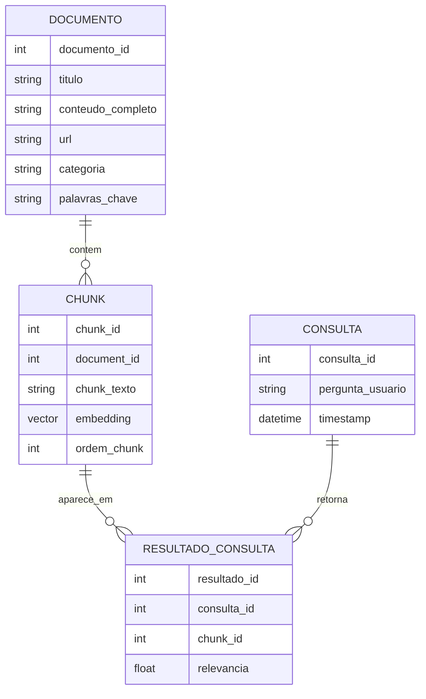

# Modelo de Dados e Estrutura Vetorial

## 1. Modelo Conceitual (MER)
O modelo conceitual descreve as principais entidades de informação manipuladas pelo sistema, desde os manuais originais até as consultas e resultados recuperados.



---

## 2. Modelo Lógico de Dados
O modelo lógico especifica as tabelas, tipos de dados, chaves primárias (PK) e chaves estrangeiras (FK) da base relacional/vetorial de apoio.

### 2.1. Tabela: `Documento`
Armazena a íntegra dos manuais, tutorias e procedimentos operacionais cadastrados para o UNO ERP.

| Coluna | Tipo | Restrição | Descrição |
| :--- | :--- | :--- | :--- |
| `document_id` | `INTEGER` | **PK** | Identificador sequencial único do documento no arquivo `knowledge_base.json`. |
| `titulo` | `VARCHAR(255)` | NOT NULL | Título da tela, rotina ou procedimento do manual. |
| `conteudo_completo` | `TEXT` | NOT NULL | Texto integral do manual ou artigo explicativo. |
| `url` | `VARCHAR(500)` | NULL | Endereço web de origem na documentação oficial da parceira. |
| `categoria` | `VARCHAR(100)` | NULL | Segmentação funcional (ex.: Faturamento, Compras, Estoque, Fiscal). |
| `palavras_chave` | `VARCHAR(500)` | NULL | Lista de termos e palavras-chave de apoio à indexação lexical. |

### 2.2. Tabela: `Chunk`
Segmentos de texto fracionados a partir dos documentos originais, respeitando janelas de contexto de tokens e sobreposição (*overlap*).

| Coluna | Tipo | Restrição | Descrição |
| :--- | :--- | :--- | :--- |
| `chunk_id` | `VARCHAR(100)` | **PK** | Identificador do chunk (formato: `{document_id}-chunk-{chunk_num}`). |
| `document_id` | `INTEGER` | **FK** | Referência ao documento de origem (`Documento.document_id`). |
| `chunk_texto` | `TEXT` | NOT NULL | Conteúdo textual fatiado para processamento. |
| `embedding` | `VECTOR(1536)` | NOT NULL | Vetor denso gerado pelo modelo `text-embedding-3-small`. |
| `ordem_chunk` | `INTEGER` | NOT NULL | Posição sequencial do chunk dentro do documento original. |

### 2.3. Tabela: `Consulta`
Registra as perguntas efetuadas pelos usuários via interface web ou canal de telefonia.

| Coluna | Tipo | Restrição | Descrição |
| :--- | :--- | :--- | :--- |
| `consulta_id` | `INTEGER` | **PK** | Identificador unívoco da sessão ou interação de busca. |
| `pergunta_usuario` | `TEXT` | NOT NULL | Dúvida textual submetida pelo operador. |
| `timestamp` | `DATETIME` | NOT NULL | Data e hora em que a consulta foi processada. |

### 2.4. Tabela: `ResultadoConsulta`
Mapeia os chunks recuperados e sua pontuação de similaridade / relevância frente à pergunta.

| Coluna | Tipo | Restrição | Descrição |
| :--- | :--- | :--- | :--- |
| `resultado_id` | `INTEGER` | **PK** | Identificador do resultado da busca. |
| `consulta_id` | `INTEGER` | **FK** | Referência à consulta efetuada (`Consulta.consulta_id`). |
| `chunk_id` | `VARCHAR(100)` | **FK** | Referência ao chunk retornado (`Chunk.chunk_id`). |
| `relevancia` | `FLOAT` | NOT NULL | Score de similaridade de cosseno ou relevância calculada no *rerank*. |

---

## 3. Estrutura de Armazenamento no ChromaDB
No código da Search API (`main.py`), a persistência vetorial é gerenciada pelo **ChromaDB**:
- **Diretório Persistente:** `base_de_conhecimento_db/`
- **Nome da Coleção:** `docs_uno_erp_cosine`
- **Métrica de Distância:** Cosseno (`{"hnsw:space": "cosine"}`)
- **Chunking com tiktoken:**
  - `max_tokens = 2000`
  - `overlap = 500` (garante preservação do contexto sem quebra abrupta de sentenças)
- **Metadados Gravados por Chunk:**
  ```json
  {
    "document_id": "314",
    "category": "Faturamento / NFe",
    "title": "Rejeição 201: Número do lote inválido",
    "full_text": "Texto completo da documentação do ERP...",
    "keywords": "rejeição 201, sefaz, lote, nota fiscal",
    "source_url": "https://wiki.unoerp.com.br/...",
    "chunk_index": 0
  }
  ```

---

## 4. Estrutura do Arquivo `knowledge_base.json`
O arquivo `knowledge_base.json` na raiz do projeto é a fonte primária de ingestão (531 artigos catalogados). Cada item do array segue o esquema:
```json
[
  {
    "Categoria": "Vendas / Faturamento",
    "Titulo": "Como emitir nota fiscal com rejeição 201",
    "Conteudo": "Procedimento passo a passo para ajuste de numeração...",
    "Palavras Chave": "rejeição 201, lote, sefaz, faturamento",
    "URL": "https://wiki.unoerp.com.br/artigo/201"
  }
]
```
Se a coleção estiver ausente ou vazia no primeiro arranque do servidor, o método `inicializar_banco()` lê este arquivo automaticamente, calcula os embeddings e popula a base vetorial.
