# Pipeline da Search API e Diagrama de Atividades

## 1. Visão Geral do Endpoint `/search`
A rota `POST /search` da API Flask é o coração do sistema de recuperação documental (*Retriever*). Ela implementa uma abordagem híbrida avançada (*Hybrid Search* + *Conditional Reranking*) composta por 6 etapas sequenciais para maximizar a precisão da resposta entregue ao modelo gerador.

---

## 2. Diagrama de Atividades da Rota `/search`

```mermaid
flowchart TD
    Start(["Inicio da rota POST /search"]) --> Recv["Recebe JSON com query ou pergunta"]
    
    Recv --> CheckQuery{"Campo de pergunta presente e valido?"}
    CheckQuery -->|"Nao"| Err400["Retorna HTTP 400 Bad Request: query ou pergunta obrigatorio"]
    Err400 --> EndSearch(["Fim da Requisicao"])

    CheckQuery -->|"Sim"| StoreQuery["Armazena pergunta original e inicia cronometro de busca"]
    
    %% Etapa 1: Expansao
    StoreQuery --> Step1["Etapa 1: Expansao da Consulta via GPT-4o-mini"]
    Step1 --> ExpResult{"Expansao via LLM teve sucesso?"}
    ExpResult -->|"Sim"| ParseExp["Extrai termos alternativos e sinonimos operacionais"]
    ExpResult -->|"Nao"| FallbackExp["Usa estritamente a pergunta original"]
    ParseExp --> CombineQueries["Compoe lista final de consultas para busca"]
    FallbackExp --> CombineQueries

    %% Etapa 2: Busca Semantica
    CombineQueries --> LoopSemantico["Etapa 2: Para cada variacao de consulta: Gera embedding e busca top 8 no ChromaDB"]
    
    %% Etapa 3: Busca Lexical
    LoopSemantico --> Step3["Etapa 3: Busca Lexical Simples por palavras-chave"]
    Step3 --> ScanDocs["Varre titulos, palavras-chave e textos completos no ChromaDB"]
    ScanDocs --> ExactMatchCheck{"Encontrou Match Exato de Rejeicao, ex: rejeicao 201 no Doc 314?"}
    ExactMatchCheck -->|"Sim"| FlagExact["Sinaliza Candidato de Match Exato com Prioridade Maxima"]
    ExactMatchCheck -->|"Nao"| AddLexical["Adiciona candidatos textuais ao pool"]
    FlagExact --> AddLexical

    %% Etapa 4: Mesclagem e Deduplicacao
    AddLexical --> Step4["Etapa 4: Mesclar e Desduplicar candidatos por document_id"]
    Step4 --> Dedup["Une candidatos semanticos e textuais eliminando duplicatas"]
    
    Dedup --> CheckEmpty{"Existem candidatos no pool final?"}
    CheckEmpty -->|"Nao"| ReturnEmpty["Retorna Lista Vazia JSON [] com HTTP 200"]
    ReturnEmpty --> EndSearch

    %% Etapa 5: Rerank Hibrido / Condicional
    CheckEmpty -->|"Sim"| CheckExactCondition{"Candidato de Match Exato identificado para Doc 314?"}
    
    CheckExactCondition -->|"Sim"| BypassRerank["Etapa 5: BYPASS DO RERANK VIA LLM: Prioriza Doc 314 + top 4 apoios semanticos"]
    
    CheckExactCondition -->|"Nao"| LLMRerank["Etapa 5: Reranking via GPT-4o-mini com prompt classificador"]
    LLMRerank --> LLMResult{"Classificacao LLM retornou JSON valido?"}
    LLMResult -->|"Sim"| UseLLMIds["Seleciona os melhores IDs ranqueados"]
    LLMResult -->|"Nao"| FallbackSlice["Fallback de Rerank: Seleciona os 5 primeiros candidatos"]
    
    BypassRerank --> Step6["Etapa 6: Montagem da Resposta"]
    UseLLMIds --> Step6
    FallbackSlice --> Step6

    %% Etapa 6: Resposta
    Step6 --> BuildJSON["Coleta metadados completos dos IDs selecionados: categoria, texto, titulo e url"]
    BuildJSON --> ReturnSuccess["Retorna JSON com documentos encontrados HTTP 200"]
    ReturnSuccess --> EndSearch
```

---

## 3. As 6 Etapas Detalhadas do Pipeline

### Etapa 1: Expansão da Consulta (*Query Expansion*)
Usuários frequentemente formulam dúvidas usando linguagem coloquial ou termos genéricos. O sistema submete a pergunta a um prompt técnico no `gpt-4o-mini` para gerar de 2 a 4 variações com foco em nomes de telas, campos operacionais e processos do UNO ERP. Caso a chamada falhe, o sistema aplica degradação graciosa (*graceful degradation*) utilizando a pergunta pura.

### Etapa 2: Busca Semântica Vetorial
Para cada variação de termo:
1. O modelo `text-embedding-3-small` gera o vetor denso correspondente.
2. É realizada uma consulta `n_results=8` no ChromaDB com métrica de similaridade de cosseno (`hnsw:space: cosine`).
3. Os metadados de cada chunk retornado são adicionados à lista de candidatos semânticos.

### Etapa 3: Busca Lexical e Detecção de Rejeições Críticas
Em paralelo à busca vetorial, o sistema efetua uma busca lexical textual nos títulos, palavras-chave e textos integrais.
- Se a consulta contiver palavras-chave críticas de rejeição fiscal (como `rejeição` ou `código`), o sistema realiza uma varredura direta no título. Se localizar uma correspondência direta (exemplo: documento `314` referente à **Rejeição 201** da SEFAZ), esse registro é marcado como **Match Exato**.

### Etapa 4: Fusão e Desduplicação por `document_id`
Os resultados obtidos nas etapas 2 e 3 são combinados em um dicionário indexado pelo `document_id`. Caso exista um candidato de match exato, ele é inserido no topo da fila prioritária. Documentos repetidos são eliminados mantendo integridade dos trechos.

### Etapa 5: Reranking Híbrido Condicional
Para determinar os documentos que realmente devem alimentar a janela de contexto da LLM:
1. **Regra de Bypass:** Se houver correspondência exata para a Rejeição 201 (Doc 314), o rerank via LLM é totalmente pulado. O sistema insere o ID 314 na primeira posição seguido de até 4 trechos de apoio. Isso elimina tempo de espera e consumo desnecessário de tokens.
2. **LLM Rerank:** Para dúvidas gerais ou ambíguas, os 800 primeiros caracteres de cada candidato são enviados ao `gpt-4o-mini`, que atua como classificador estrito retornando apenas os top 5 IDs em JSON.
3. **Fallback:** Em caso de oscilação do serviço da OpenAI, o sistema seleciona os 5 primeiros candidatos da etapa 4 sem interrupção do serviço.

### Etapa 6: Serialização e Retorno
A API formata os documentos finais selecionados em um array JSON uniforme contendo `categoria`, `texto_completo`, `titulo` e `url`, registrando métricas de latência em milissegundos nos logs do servidor.
