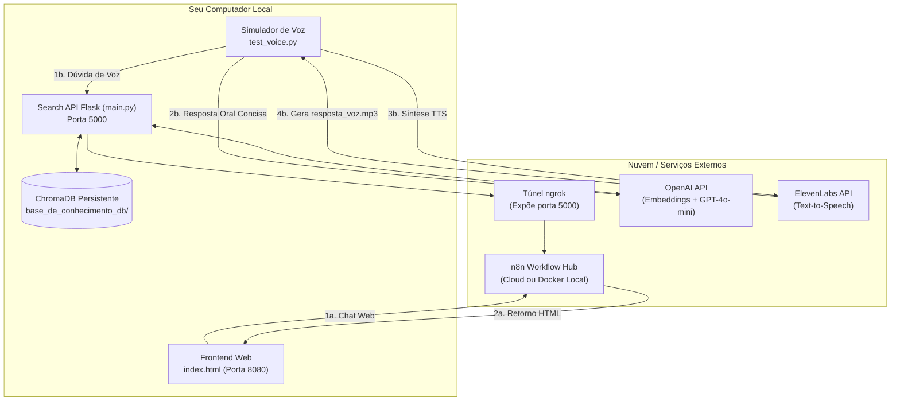

# Guia Completo de Execução Local: Web, n8n e Canal de Voz (ElevenLabs)

Este manual detalha o passo a passo completo para configurar, executar e testar o ecossistema do **ERP Helpper** em seu ambiente local, abrangendo a **Search API (Flask/ChromaDB)**, a orquestração no **n8n** e o **Canal de Voz inteligente com ElevenLabs**.

---

## 1. Arquitetura da Execução Local



---

## 2. Pré-Requisitos do Sistema

Antes de iniciar, certifique-se de possuir:
1. **Python 3.10** ou superior instalado ([python.org](https://www.python.org/downloads/)).
2. **Git** configurado no terminal.
3. **Chave de API da OpenAI** com saldo ativo ([platform.openai.com](https://platform.openai.com/)).
4. **Chave de API da ElevenLabs** (plano Free ou pago em [elevenlabs.io](https://elevenlabs.io/)).
5. *(Opcional)* **ngrok** instalado para expor sua máquina local ao n8n Cloud ([ngrok.com](https://ngrok.com/)).

---

## 3. Passo a Passo: Configuração do Ambiente e Search API

### Passo 1: Clonar o Repositório
```bash
git clone https://github.com/fonseca0015/chatBotAWS1.git
cd chatBotAWS1
```

### Passo 2: Criar e Ativar o Ambiente Virtual (`venv`)
- **No Windows (PowerShell):**
  ```powershell
  python -m venv venv
  .\venv\Scripts\Activate.ps1
  ```
- **No Windows (CMD):**
  ```cmd
  python -m venv venv
  venv\Scripts\activate.bat
  ```
- **No Linux / macOS:**
  ```bash
  python3 -m venv venv
  source venv/bin/activate
  ```

### Passo 3: Instalar as Dependências
```bash
pip install --upgrade pip
pip install -r requirements.txt
```

### Passo 4: Configurar o Arquivo `.env`
Copie o modelo de configuração:
```bash
# Windows
Copy-Item .env.example .env

# Linux / macOS
cp .env.example .env
```

Edite o arquivo `.env` gerado e preencha suas credenciais:
```dotenv
# Credenciais Obrigatórias
OPENAI_API_KEY=sk-proj-sua-chave-openai-aqui
ELEVENLABS_API_KEY=sua-chave-elevenlabs-aqui

# Configurações do Canal de Voz
ELEVENLABS_VOICE_ID=21m00Tcm4TlvDq8ikWAM
SEARCH_API_URL=http://127.0.0.1:5000/search

# Configurações da API
PORT=5000
DB_PATH=base_de_conhecimento_db
COLLECTION_NAME=docs_uno_erp_cosine
```

### Passo 5: Iniciar a Search API e o Banco Vetorial
```bash
python main.py
```
> **O que ocorre:** O servidor verifica a pasta `base_de_conhecimento_db/`. Caso esteja vazia, lerá os 531 artigos do `knowledge_base.json`, gerará os embeddings e iniciará o servidor na porta `5000`.

---

## 4. Passo a Passo: Execução e Teste do Canal de Voz (ElevenLabs)

Para simular o atendimento telefônico com IA em sua máquina local sem precisar de um gateway de telefonia ativo, o projeto inclui o script automatizado **`test_voice.py`**.

### Como Funciona a Simulação de Voz:
1. O script recebe a dúvida do usuário (simulando a fala transcrita por STT).
2. Consulta a Search API local (`http://127.0.0.1:5000/search`) para recuperar os trechos técnicos da documentação do UNO ERP.
3. Utiliza o `gpt-4o-mini` com diretrizes estritas para voz: linguagem cordial e respostas ultra-objetivas ($\le 250$ caracteres), sem tabelas, markdown ou links.
4. Envia o texto gerado para a **API do ElevenLabs** (`model_id: eleven_multilingual_v2`).
5. Recebe os bytes de áudio e grava o arquivo **`resposta_voz.mp3`** na raiz do projeto.

### Executando o Teste de Voz:
Abra um novo terminal (com o `venv` ativado) e execute:
```bash
python test_voice.py "Como resolver a rejeição 201 da nota fiscal?"
```

#### Exemplo de Saída Esperada no Console:
```text
=================================================================
 🎙️ SIMULAÇÃO DO CANAL DE VOZ - ERP HELPPER (ELEVENLABS + RAG)
=================================================================
Dúvida do usuário: "Como resolver a rejeição 201 da nota fiscal?"

[1/4] Consultando Search API em 'http://127.0.0.1:5000/search'...
      Recuperados 5 documentos da base de conhecimento.

[2/4] Gerando resposta adaptada para voz (GPT-4o-mini)...
      Texto gerado para fala:
      "Olá! A rejeição 201 indica duplicidade ou inconsistência no número do lote. Para corrigir, acerte a numeração no módulo de faturamento e retransmita a nota."

[3/4] Sintetizando voz via ElevenLabs API (Voice ID: 21m00Tcm4TlvDq8ikWAM)...

[4/4] Áudio gerado com sucesso em 1.18s!
      Arquivo salvo: C:\...\chatBotAWS1\resposta_voz.mp3 (42.3 KB)
      Dê play no arquivo 'resposta_voz.mp3' para ouvir a IA falar!
```

> **Para ouvir o resultado:** Dê um duplo clique no arquivo `resposta_voz.mp3` gerado na pasta do projeto para escutar a voz humanizada da IA!

---

## 5. Passo a Passo: Integrando com o n8n

O **n8n** atua como orquestrador central recebendo os dados do chat ou da telefonia.

### Opção A: Usando o n8n Cloud com Túnel ngrok (Mais Fácil)
1. Com a Search API rodando localmente na porta 5000, abra outro terminal e execute:
   ```bash
   ngrok http 5000
   ```
2. O ngrok exibirá uma URL pública segura (ex.: `https://a1b2-c3d4.ngrok-free.app`).
3. Acesse o seu painel no n8n Cloud e abra o workflow do ERP Helpper (ou importe o arquivo [`n8n/workflow_uno_erp_helpper.json`](../n8n/workflow_uno_erp_helpper.json)).
4. No nó **HTTP Request**, altere a URL de `http://44.203.191.31:5000/search` para:
   ```text
   https://a1b2-c3d4.ngrok-free.app/search
   ```
5. Clique em **Save** e ative o botão **Active**. Agora o fluxo na nuvem se comunica diretamente com a sua máquina local!

### Opção B: Rodando o n8n Localmente via Docker
Caso queira rodar o n8n 100% na sua máquina:
```bash
docker run -it --rm --name n8n -p 5678:5678 -v ~/.n8n:/home/node/.n8n n8nio/n8n
```
Acesse `http://localhost:5678`, importe o arquivo `n8n/workflow_uno_erp_helpper.json` e aponte o nó HTTP Request para `http://host.docker.internal:5000/search`.

---

## 6. Passo a Passo: Executando a Interface Web (`index.html`)

A interface web pode ser aberta diretamente no navegador:

### Execução via Servidor Local (Recomendado):
```bash
# Na raiz do projeto, execute:
python -m http.server 8080
```
Acesse no seu navegador: **`http://localhost:8080`**.

Digite uma pergunta (ex: `rejeição 201` ou `como cadastrar fornecedor`) e observe a resposta formulada com animação de digitação e links oficiais de referência!

---

## 7. Testes Rápidos Automatizados da API

Você pode validar a integridade de qualquer ponta usando o script utilitário `test_api.py`:

```bash
# 1. Testar Search API local:
python test_api.py

# 2. Testar Search API em produção na AWS EC2:
python test_api.py aws

# 3. Testar o Webhook oficial do n8n:
python test_api.py n8n
```

---

## 8. Resolução de Problemas Comuns (*Troubleshooting*)

- **Erro `ELEVENLABS_API_KEY não configurada`:**
  - Cadastre-se gratuitamente no [ElevenLabs](https://elevenlabs.io/), copie a chave da sua conta em *Profile > API Keys* e cole no `.env`.
- **Erro de cota esgotada no ElevenLabs (HTTP 401 / 429):**
  - O plano gratuito fornece 10.000 créditos por mês. Monitore o painel da ElevenLabs ou ative uma nova chave de teste.
- **Erro `openai.AuthenticationError`:**
  - Verifique se a variável `OPENAI_API_KEY` possui créditos ativos na OpenAI.
- **Porta 5000 ocupada:**
  - No Windows, encerre processos concorrentes com `netstat -ano | findstr :5000` e finalize com `taskkill /PID <PID> /F`.
