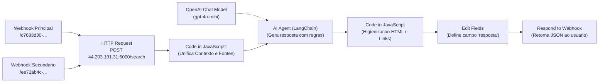

# Workflow do n8n — Assistente Inteligente UNO ERP

Este documento detalha o fluxo de orquestração construído no **n8n**, responsável por conectar o frontend do chatbot (ou o canal de voz/telefonia), consultar a Search API em execução na AWS EC2, estruturar o contexto documental e gerar a resposta final com o modelo `gpt-4o-mini` da OpenAI.

O arquivo com o fluxo completo pronto para importação no n8n encontra-se em:  
📁 **[`n8n/workflow_uno_erp_helpper.json`](../n8n/workflow_uno_erp_helpper.json)**

---

## 1. Diagrama do Workflow no n8n



---

## 2. Nós do Fluxo e Suas Responsabilidades

### 2.1. Nós de Entrada (`Webhook` e `Webhook1`)
- **Tipo:** `n8n-nodes-base.webhook` (v2.1)
- **Método:** `POST`
- **Paths de Acionamento:**
  - Principal: `c7683d30-5ffb-448b-a9cb-2dac0ac443bb`
  - Secundário (Espelho/Testes): `ee72ab4c-cf1b-4b3b-a8cd-ca8ce6260556`
- **Payload Recebido:**
  ```json
  {
    "pergunta": "Como resolver a rejeição 201?"
  }
  ```

---

### 2.2. Nó de Consulta RAG (`HTTP Request`)
- **Tipo:** `n8n-nodes-base.httpRequest` (v4.2)
- **Endpoint:** `http://44.203.191.31:5000/search` *(Search API Flask em execução na AWS EC2)*
- **Body Enviado:**
  ```json
  {
    "query": "{{ $json.body.pergunta || $json.body.query || $json.body.user_message }}"
  }
  ```
- **Retorno Esperado:** Lista JSON de documentos com `titulo`, `categoria`, `texto_completo` e `url`.

---

### 2.3. Nó de Agregação de Contexto (`Code in JavaScript1`)
- **Tipo:** `n8n-nodes-base.code`
- **Função:** Itera sobre todos os trechos retornados pela Search API, unifica os textos em uma string formatada de `CONTEXTO`, compila as URLs únicas em `FONTES` e resgata a pergunta original:
```javascript
const documentos = $input.all();
let contextoUnificado = "";
let fontesUnificadas = [];

documentos.forEach((doc, index) => {
  const d = doc.json;
  if (d.texto_completo) {
    contextoUnificado += `\n\n--- DOCUMENTO ${index + 1}: ${d.titulo || ''} ---\n${d.texto_completo}`;
  }
  if (d.url && !fontesUnificadas.includes(d.url)) {
    fontesUnificadas.push(d.url);
  }
});

let perguntaOriginal = "";
try {
  perguntaOriginal = $('Webhook').first().json.body.pergunta || $('Webhook').first().json.body.query || "";
} catch (e) {
  perguntaOriginal = "";
}

return [{
  json: {
    contexto: contextoUnificado,
    fontes: fontesUnificadas.join("\n"),
    pergunta: perguntaOriginal
  }
}];
```

---

### 2.4. Nó de Inteligência Artificial (`AI Agent` + `OpenAI Chat Model`)
- **Motor LLM:** OpenAI `gpt-4o-mini`
- **Estrutura do Prompt do Usuário:**
  ```text
  ---
  CONTEXTO:
  {{ $json.contexto }}
  ---
  FONTES:
  {{ $json.fontes }}
  ---
  PERGUNTA DO USUÁRIO:
  {{ pergunta }}
  ---
  ```
- **Diretrizes e Regras de Negócio no `System Message`:**
  1. **Tom Amigável e Visual:** Uso de emojis (✅, ❌, 👉, 💡) para dinamismo.
  2. **Estrita Aderência aos Fatos:** Proibição de inventar rotinas; resposta 100% restrita à seção `CONTEXTO`.
  3. **Didática Passo a Passo:** Organização em 1º Passo, 2º Passo para procedimentos.
  4. **Citação de Fontes Oficiais:** Restringe fontes estritamente aos links da base de conhecimento homologada do UNO ERP.
  5. **Tratamento de Dúvidas Não Encontradas:** Resposta transparente orientando reformulação caso a informação não conste na base.
  6. **Tratamento de Saudações:** Cumprimento breve e simpático sem poluição técnica quando o usuário apenas envia "oi", "bom dia", etc.
  7. **Proatividade com Problemas Genéricos:** Inferência de intenção (ex.: erro de CEP direcionado para cadastros de municípios/bairros).

---

### 2.5. Nó de Formatação e Higienização HTML (`Code in JavaScript`)
- **Tipo:** `n8n-nodes-base.code`
- **Objetivo:** Preparar a saída da IA para renderização sem falhas na interface web:
  1. Remove marcadores markdown brutos `### `.
  2. Converte negritos markdown `**texto**` para tags HTML `<strong>texto</strong>`.
  3. Converte links markdown `[texto](url)` para `<a href="..." target="_blank">` exclusivamente se pertencerem ao domínio oficial (`unoerpwiki.herokuapp.com`).
  4. Substitui quebras de linha `\n` por tags `<br>`.

---

### 2.6. Nó de Retorno (`Edit Fields` e `Respond to Webhook`)
- **Tipo:** `n8n-nodes-base.respondToWebhook`
- **Payload de Resposta:**
  ```json
  {
    "resposta": "Olá! Segue o procedimento para emitir sua nota fiscal...<br><strong>1º Passo:</strong>..."
  }
  ```

---

## 3. Como Importar o Workflow no Seu n8n

1. Abra a sua instância do n8n (Cloud ou Self-Hosted).
2. Clique no menu superior direito **Workflows > Import from File** (ou utilize o atalho `Ctrl + O`).
3. Selecione o arquivo [`n8n/workflow_uno_erp_helpper.json`](../n8n/workflow_uno_erp_helpper.json).
4. Associe as suas credenciais da OpenAI no nó **OpenAI Chat Model**.
5. Verifique a URL do nó **HTTP Request**:
   - Caso esteja rodando na nuvem AWS, utilize `http://44.203.191.31:5000/search`.
   - Caso esteja rodando localmente com ngrok, substitua pela sua URL do túnel `https://xxxx.ngrok-free.app/search`.
6. Clique em **Save** e ative o botão **Active** para colocar o workflow em produção.
